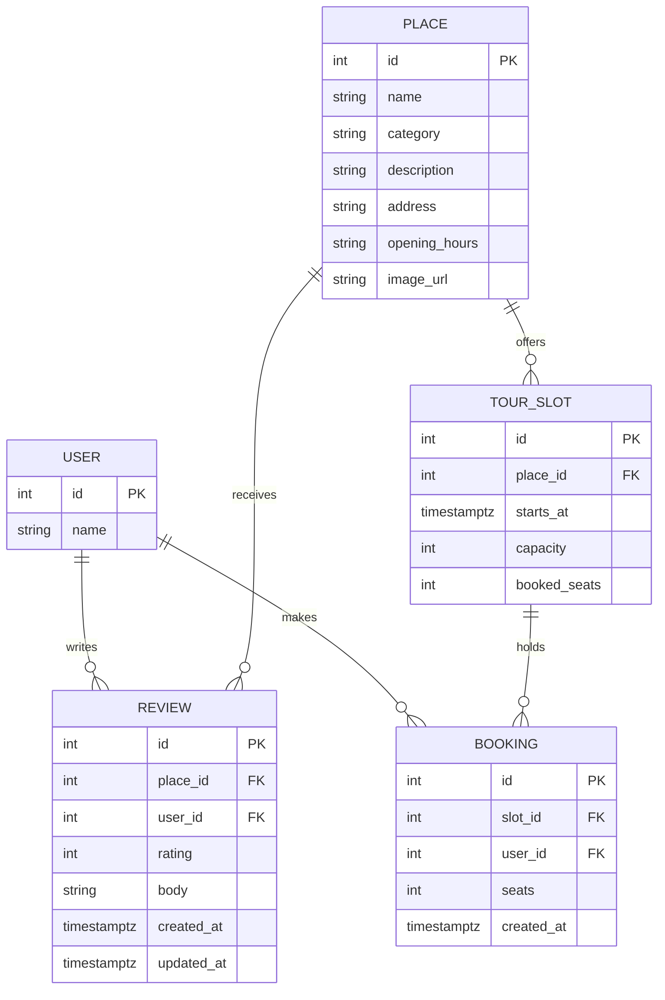

# Wayfarer — Project Guide

## 1. System Architecture & Database Models

Wayfarer is a full-stack application backed by PostgreSQL 18 and Prisma ORM.

### 1.1 Database Entities & Responsibilities

#### Entity Details:
1. **`users` (`User`)**: Represents travelers. Fixed IDs `1` (Ana), `2` (Bruno), and `3` (Carla) are seeded to provide stable acting-as identities.
   - *Sequence Safety*: After inserting fixed IDs in the seed, PostgreSQL's sequence `users_id_seq` is manually advanced with `SELECT setval(pg_get_serial_sequence('users', 'id'), COALESCE(MAX(id), 1))` so future inserts never collide.
2. **`places` (`Place`)**: Real venues across Lisbon. Contains `address` (displayed in header) and `image_url` (nullable; falls back to designed placeholder). Indexed by `category`.
3. **`reviews` (`Review`)**: Ratings and commentary.
   - *Composite Unique Constraint*: `UNIQUE (place_id, user_id)` guarantees one review per user per place at the storage engine level.
   - *`updated_at` Timestamp*: Configured with `@updatedAt`. Note: `@updatedAt` is maintained by Prisma Client operations; raw SQL updates do not automatically update this field unless explicitly modified.
   - *Check Constraint*: `CHECK (rating BETWEEN 1 AND 5)`.
4. **`tour_slots` (`TourSlot`)**: Scheduled tour sessions with start times and seat capacities.
   - *Check Constraints*: `CHECK (capacity > 0)` and `CHECK (booked_seats >= 0 AND booked_seats <= capacity)`.
   - *Composite Index*: `(place_id, starts_at)` optimizes chronological slot loading for place details.
5. **`bookings` (`Booking`)**: Individual seat reservations.
   - *Check Constraint*: `CHECK (seats > 0)`.
   - *Index*: `(slot_id)` optimizes seat summation queries.

---

## 2. Invariant: `bookedSeats` vs. `Booking` Records

For every tour slot, the following invariant must hold at all times:
$$\text{booked\_seats} = \sum(\text{booking.seats}) \quad \text{and} \quad 0 \le \text{booked\_seats} \le \text{capacity}$$

- **Purpose**: Enables atomic single-statement check-and-reserve (`UPDATE tour_slots SET booked_seats = booked_seats + $seats WHERE id = $slotId AND booked_seats + $seats <= capacity`) without multi-statement locking.
- **Drift Prevention**:
  1. Single write path: Only `bookingService.bookSeats` and the seed script write to `booked_seats` or `bookings`.
  2. Transactional coupling: Both writes happen inside the same PostgreSQL interactive transaction.
  3. Database constraint: PostgreSQL actively rejects any row where `booked_seats > capacity` or `booked_seats < 0`.
  4. Audit helper: `assertSlotConsistent(prisma, slotId)` audits this invariant after every booking test and after seeding.

---

## 3. Database Migrations & Validation

- Hand-edited migrations inject named `CHECK` constraints that Prisma schema cannot express directly.
- Workflow:
  1. `npx prisma validate`
  2. `npx prisma migrate dev --name <migration_name> --create-only`
  3. Hand-edit the generated SQL to add constraints.
  4. Apply with `npx prisma migrate dev`.

---

## 4. Idempotent Seed Data (Lisbon Dataset)

- Executed with `npm run db:seed`.
- **Safety**: Inspects `SELECT current_database()` and aborts if not connected to `wayfarer`. It refuses to run against `wayfarer_test`.
- **Idempotency**: Executes `TRUNCATE TABLE users, places, reviews, tour_slots, bookings RESTART IDENTITY CASCADE` before inserting.
- **Dataset**:
  - 3 users (Ana, Bruno, Carla).
  - 10 Lisbon places across 5 categories.
  - 23 reviews summing to 92 (global mean $C = 4.000$).
  - 5 tour slots with exact matching bookings (e.g. Alfama slot 1 has 2 seats left; Alfama slot 2 is full).
- **Synthetic Data Label (RV-8)**: All reviews and tour slots are synthetic demonstration data.

---

## 5. Test Database Isolation

- Development: `wayfarer`
- Tests: `wayfarer_test`
- Pre-connection guard `assertTestDatabase(testUrl, devUrl)` throws before test execution if `TEST_DATABASE_URL` is missing, equal to `DATABASE_URL`, or doesn't contain `test`.
- `resetDatabase()` runtime-checks `SELECT current_database()` before truncating test tables.
- Development database data is never touched by tests.
