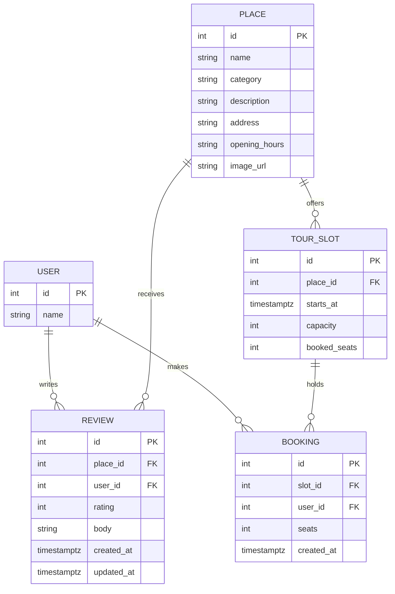

# Wayfarer — Project Guide

## 1. System Architecture & Database Models

Wayfarer is a full-stack application backed by PostgreSQL 18 and Prisma ORM.

### 1.1 Database Entities & Responsibilities



#### Entity Details:
1. **`users` (`User`)**: Represents travelers. Fixed IDs `1` (Ana), `2` (Bruno), and `3` (Carla) are seeded to provide stable acting-as identities.
   - *Sequence Safety*: After inserting fixed IDs in the seed, PostgreSQL's sequence `users_id_seq` is manually advanced with `SELECT setval(pg_get_serial_sequence('users', 'id'), COALESCE(MAX(id), 1))` so future inserts never collide.
2. **`places` (`Place`)**: Real venues across Lisbon. Contains `address` (displayed in header) and `image_url` (nullable; falls back to designed placeholder). Indexed by `category`.
3. **`reviews` (`Review`)**: Ratings and commentary.
   - *Composite Unique Constraint*: `UNIQUE (place_id, user_id)` guarantees one review per user per place at the storage engine level.
   - *`updated_at` Timestamp*: Configured with `@updatedAt`. Note: `@updatedAt` is maintained by Prisma Client operations; raw SQL updates do not automatically update this field unless explicitly modified.
   - *Check Constraint*: `CHECK (rating BETWEEN 1 AND 5)`.
4. **`tour_slots` (`TourSlot`)**: Scheduled tour sessions with start times and seat capacities.
   - *Check Constraints*: `CHECK (capacity > 0)` and `CHECK (booked_seats >= 0 AND booked_seats <= capacity)`.
   - *Composite Index*: `(place_id, starts_at)` optimizes chronological slot loading for place details.
5. **`bookings` (`Booking`)**: Individual seat reservations.
   - *Check Constraint*: `CHECK (seats > 0)`.
   - *Index*: `(slot_id)` optimizes seat summation queries.

---

## 2. Invariant: `bookedSeats` vs. `Booking` Records

For every tour slot, the following invariant must hold at all times:
$$\text{booked\_seats} = \sum(\text{booking.seats}) \quad \text{and} \quad 0 \le \text{booked\_seats} \le \text{capacity}$$

- **Purpose**: Enables atomic single-statement check-and-reserve (`UPDATE tour_slots SET booked_seats = booked_seats + $seats WHERE id = $slotId AND booked_seats + $seats <= capacity`) without multi-statement locking.
- **Drift Prevention**:
  1. Single write path: Only `bookingService.bookSeats` and the seed script write to `booked_seats` or `bookings`.
  2. Transactional coupling: Both writes happen inside the same PostgreSQL interactive transaction.
  3. Database constraint: PostgreSQL actively rejects any row where `booked_seats > capacity` or `booked_seats < 0`.
  4. Audit helper: `assertSlotConsistent(prisma, slotId)` audits this invariant after every booking test and after seeding.

---

## 3. Database Migrations & Validation

- Hand-edited migrations inject named `CHECK` constraints that Prisma schema cannot express directly.
- Workflow:
  1. `npx prisma validate`
  2. `npx prisma migrate dev --name <migration_name> --create-only`
  3. Hand-edit the generated SQL to add constraints.
  4. Apply with `npx prisma migrate dev`.

---

## 4. Idempotent Seed Data (Lisbon Dataset)

- Executed with `npm run db:seed`.
- **Safety**: Inspects `SELECT current_database()` and aborts if not connected to `wayfarer`. It refuses to run against `wayfarer_test`.
- **Idempotency**: Executes `TRUNCATE TABLE users, places, reviews, tour_slots, bookings RESTART IDENTITY CASCADE` before inserting.
- **Dataset**:
  - 3 users (Ana, Bruno, Carla).
  - 10 Lisbon places across 5 categories.
  - 23 reviews summing to 92 (global mean $C = 4.000$).
  - 5 tour slots with exact matching bookings (e.g. Alfama slot 1 has 2 seats left; Alfama slot 2 is full).
- **Synthetic Data Label (RV-8)**: All reviews and tour slots are synthetic demonstration data.

---

## 5. Test Database Isolation

- Development: `wayfarer`
- Tests: `wayfarer_test`
- Pre-connection guard `assertTestDatabase(testUrl, devUrl)` throws before test execution if `TEST_DATABASE_URL` is missing, equal to `DATABASE_URL`, or doesn't contain `test`.
- `resetDatabase()` runtime-checks `SELECT current_database()` before truncating test tables.
- Development database data is never touched by tests.

---

## 6. Place Discovery, Filtering, and Ranking (Slice 2)

### 6.1 Request Path
```text
Browser -> GET /api/places?category=History&sort=top-rated
  -> routes/places.ts
  -> controllers/placeController.ts (parseCategory, parseSort)
  -> services/placeService.ts
  -> lib/ranking.ts (pure score calculation & comparators)
  -> JSON response { places: [...] }
```

### 6.2 Efficient Aggregations
To prevent N+1 queries when loading places:
1. `prisma.review.aggregate` fetches the overall system review count and average in a single SQL query to establish the global prior $C$.
2. `prisma.review.groupBy` retrieves counts and averages grouped by `placeId` in a single SQL statement.
3. Review stats are indexed in an in-memory hash map for $O(1)$ lookups when assembling the ranked list.

### 6.3 Ranking Algorithm
Pure calculation in `server/src/lib/ranking.ts`:
- **Formula**: `score = (v / (v + 10)) * R + (10 / (v + 10)) * C`
- **Ties broken deterministically**: `score` (desc) $\rightarrow$ `reviewCount` (desc) $\rightarrow$ `name` (asc).
- **Invariance**: $C$ is computed globally so category filters never skew a place's prior or relative score.


---

## 7. Place Details, Reviews & Acting-as Identity (Slice 3)

### 7.1 Endpoints
- `GET /api/users`: Returns seeded users `[{ id: 1, name: "Ana" }, ...]`.
- `GET /api/places/:id`: Returns place metadata, average rating, review count, reviews array (newest first), upcoming tour slots, and `myReview` for the acting user.
- `PUT /api/places/:id/review`: Requires `X-User-Id`. Creates or updates the acting user's review for the place.

### 7.2 Acting-As Header & Scoped Middleware
- Header: `X-User-Id: <integer>`.
- `attachUser`: Checks `X-User-Id` if present, validates against PostgreSQL, and sets `req.user`. Non-numeric or unknown ID returns 401 `INVALID_USER`.
- `requireUser`: Enforces that `req.user` is present; returns 401 `USER_REQUIRED` if absent.

### 7.3 Frontend Components & Architecture
- `CurrentUserContext`: Restores acting user from `localStorage`, provides user state, and configures `api.ts` to attach `X-User-Id` to all API requests. Changing user immediately re-renders active pages.
- `UserSwitcher`: Accessible `<select>` dropdown in `AppHeader` to switch between Ana, Bruno, and Carla.
- `PlaceDetailsPage` (`/places/:id`): Hero image/placeholder, address, hours, rating summary, tour slots preview, review form with character counter, and reviews list with `"You"` badges.

---

## 8. Tour Slots & Safe Booking (Slice 4)

### 8.1 Booking API
- `POST /api/slots/:slotId/bookings`
- Header: `X-User-Id` (mandatory via `[attachUser, requireUser]`)
- Body: `{ "seats": <integer 1-10> }`
- Validation: Validated on the backend via `parseSeats` with constant `MAX_SEATS_PER_BOOKING = 10`. Requests for 11 seats return 400 `VALIDATION_ERROR` with `{ details: { maxSeats: 10 } }`.
- Success: HTTP 201 with `{ booking: { id, slotId, seats, createdAt }, slot: { id, capacity, seatsLeft } }`.

### 8.2 Safe Concurrency Architecture
- Implemented in `server/src/services/bookingService.ts`.
- Uses a conditional `UPDATE` inside `prisma.$transaction`:
  ```sql
  UPDATE tour_slots
  SET booked_seats = booked_seats + $seats
  WHERE id = $slotId
    AND booked_seats + $seats <= capacity;
  ```
- If 0 rows updated, inspects slot state and returns 404 `NOT_FOUND`, 409 `SLOT_FULL` (`{ seatsLeft: 0 }`), or 409 `NOT_ENOUGH_SEATS` (`{ seatsLeft: n }`).
- If 1 row updated, inserts `Booking` record in the same transaction.

### 8.3 Frontend Tour Slot List
- `TourSlotList`: Interactive booking panel on Place Details page.
- Selects 1 up to `min(seatsLeft, 10)` seats.
- Disables submit during pending requests to prevent double-clicks.
- Friendly messages on 409 conflicts: `"Sorry, this tour just filled up"` or `"Only N seats are left now. Pick a smaller group."` with immediate auto-reload.

---

## 9. Integration, UX Completion & Quality Assurance (Slice 5)

### 9.1 Global Backend Error Standardization
- **404 Route Catch-All**: Any unmatched route starting with `/api/` returns a 404 response adhering to the standard error contract:
  ```json
  {
    "error": {
      "code": "NOT_FOUND",
      "message": "API endpoint not found: METHOD /api/..."
    }
  }
  ```
- **500 Sanitization**: Unexpected server errors caught by `errorHandler` log diagnostic details on the server while returning a sanitized JSON response `{ "error": { "code": "INTERNAL_ERROR", "message": "An unexpected internal error occurred." } }` without exposing stack traces or internals.

### 9.2 UI State Resilience & Visual Polish
- **Designed Hero & Card Placeholders**: `PlaceImage` handles null or missing images cleanly:
  - Card grid: Preserves uniform 3:2 aspect ratio with category icon and muted background.
  - Detail hero: For places without photos, renders a compact ~120px header band (`h-28 sm:h-32`) to keep key details, ratings, and booking panels above the fold.
- **Race Condition & User-Switching Protection**: The `useApi` hook uses a request tracking ID to discard stale API responses when users switch rapidly.
- **Responsive Layout**: Fluid flex and CSS grid containers collapse without horizontal scroll down to 390px (mobile) and 768px (tablet).
- **Synthetic Data Notices**: Clear persistent notices inform users that review content and tour slot schedules are synthetic demonstration data.
- **WCAG AA/AAA Contrast**: High-contrast slate color tokens ensure readability across light and dark backgrounds.
